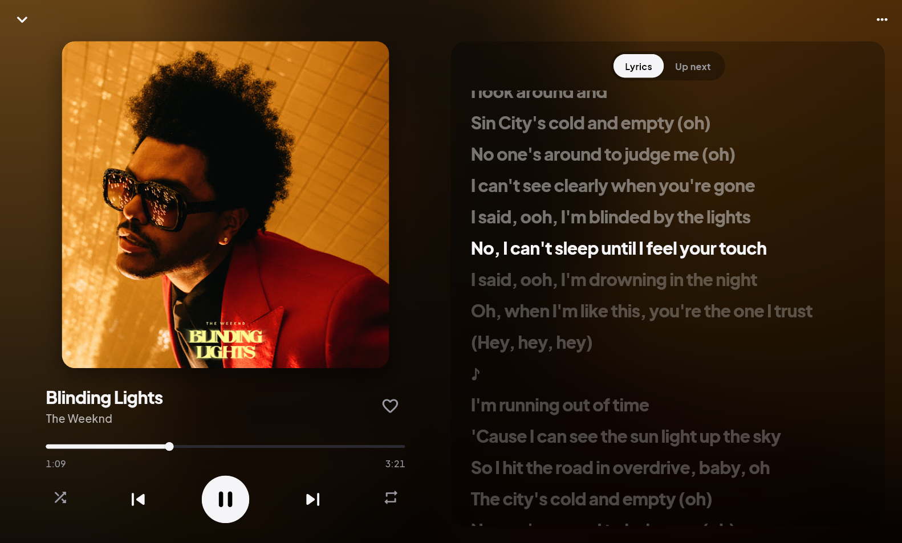
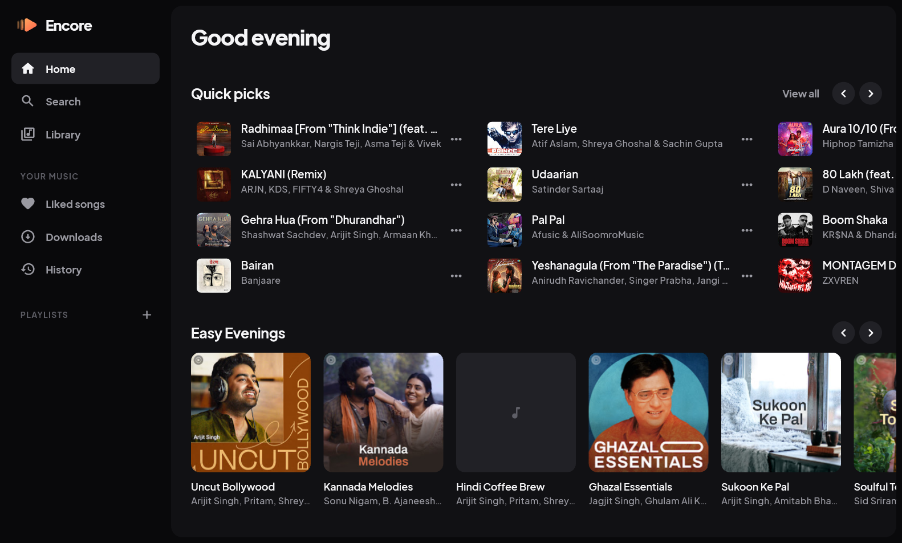
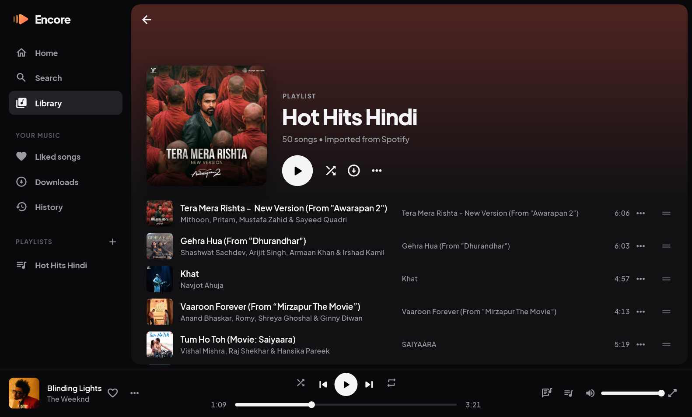
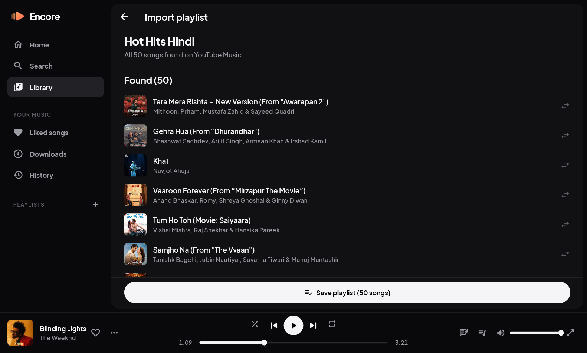
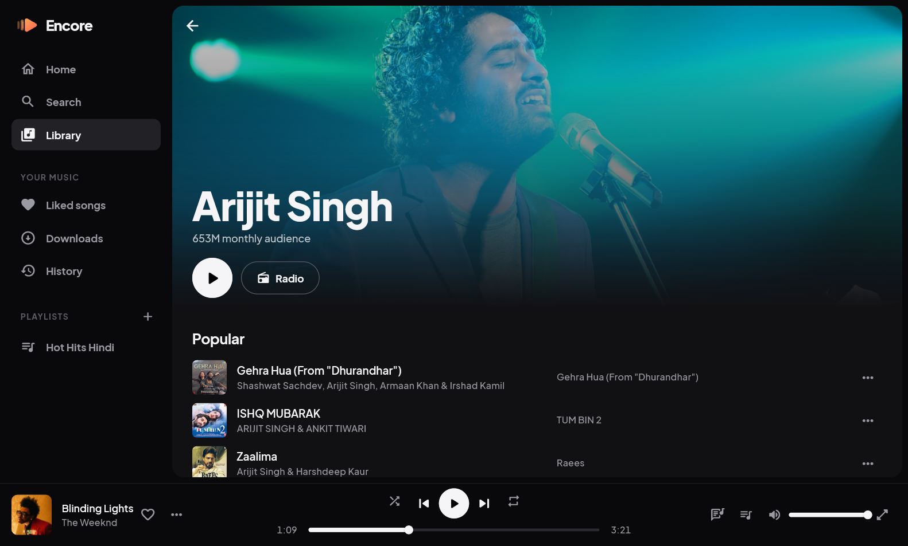

<p align="center">
  
</p>

<h1 align="center">Encore</h1>

<p align="center">
  <b>An ad-free, open-source music player for YouTube Music.</b><br>
  No ads. No account. No tracking. For Android, Windows and Linux.
</p>

<p align="center">
  <a href="https://github.com/mohdaffankhan/encore/releases/latest"></a>
  <a href="https://github.com/mohdaffankhan/encore/releases"></a>
  <a href="https://github.com/mohdaffankhan/encore/actions/workflows/build.yml"></a>
  <a href="LICENSE"></a>
  
</p>

<p align="center">
  <a href="#download">Download</a> ·
  <a href="#features">Features</a> ·
  <a href="#install">Install</a> ·
  <a href="#faq">FAQ</a> ·
  <a href="CONTRIBUTING.md">Contributing</a>
</p>

<p align="center">
  
</p>

<p align="center">
  
  
  
  
</p>

## Download

| Platform | Get it |
|---|---|
| **Android** 7.0+ | [`encore-android.apk`](https://github.com/mohdaffankhan/encore/releases/latest/download/encore-android.apk) (any phone) · smaller, per chip: [arm64-v8a](https://github.com/mohdaffankhan/encore/releases/latest/download/encore-android-arm64-v8a.apk) (most phones) · [armeabi-v7a](https://github.com/mohdaffankhan/encore/releases/latest/download/encore-android-armeabi-v7a.apk) (older phones) · [x86_64](https://github.com/mohdaffankhan/encore/releases/latest/download/encore-android-x86_64.apk) |
| **Windows** 10 / 11 | [`encore-windows-setup.exe`](https://github.com/mohdaffankhan/encore/releases/latest/download/encore-windows-setup.exe) · [portable zip](https://github.com/mohdaffankhan/encore/releases/latest/download/encore-windows-portable.zip) |
| **Linux** x64 | [`encore-linux-x64.tar.gz`](https://github.com/mohdaffankhan/encore/releases/latest/download/encore-linux-x64.tar.gz) |

All downloads are on the [Releases](https://github.com/mohdaffankhan/encore/releases)
page. Install steps for each are [below](#install).

## Features

**Listen**
- Everything on YouTube Music: songs, albums, artists, playlists, and
  videos such as covers and lyric videos
- Paste a YouTube or YouTube Music link into search to play that exact song
- Song radio, up next, shuffle and repeat
- Synced lyrics that follow the song; tap a line to jump there
- Sleep timer (15 minutes to an hour, or the end of the song) that fades out
- Swipe the player sideways for the next or previous song; on phones, swipe
  up for lyrics and down to close

**Your library, on your device**
- Likes, history and your own playlists (add, reorder, rename)
- Import public playlists from **YouTube Music**, **YouTube** or **Spotify**
  by pasting their link
- Take a playlist with you: open it in YouTube, or copy its song list for
  other apps
- Downloads for offline listening

**Everywhere**
- Android: plays in the background, with controls in the notification panel
  and on the lock screen
- Desktop: keyboard shortcuts and media keys

## Install

### Android

1. Download **`encore-android.apk`** on your phone and open it. If asked,
   allow your browser or file manager to *install unknown apps*.
2. Open Encore and tap **Allow** when it asks to show notifications: that is
   what puts the player in your notification panel.

To update, install the new APK over the old one. Your library stays.

The per-chip APKs are about a third of the size. Not sure which chip your
phone has? Take `encore-android.apk`, which works on all of them; you can
switch between it and a per-chip one any time, keeping your library.

### Windows

Run **`encore-windows-setup.exe`**. It needs no admin rights and adds Encore
to the Start menu. If SmartScreen says it protected your PC, click
**More info → Run anyway** (the installer isn't code-signed).

Prefer no installer? Unzip **`encore-windows-portable.zip`** anywhere and run
`encore.exe`.

### Linux

Encore needs `libmpv` for sound:

```sh
sudo apt install libmpv2      # Debian, Ubuntu (libmpv1 on older releases)
sudo dnf install mpv-libs     # Fedora
sudo pacman -S mpv            # Arch
```

Then extract the download and run its installer, which needs no root and
adds Encore to your app menu:

```sh
mkdir encore && tar -xzf encore-linux-x64.tar.gz -C encore
./encore/install.sh           # ./encore/install.sh --uninstall to remove
```

To update, do the same with the new download. A Flatpak and an AUR package
are on the way.

## Keyboard shortcuts

| Key | Action |
|---|---|
| Space or K | Play / pause |
| ← / → | Seek 10 seconds |
| Ctrl + ← / → | Previous / next song |
| Ctrl + ↑ / ↓ | Volume |
| L | Like the current song |
| Esc | Leave the search box (keys type there while it is active) |

Media keys on your keyboard work too.

## FAQ

**Is it free? Are there ads?**
Free, with no ads, ever. Encore is open source (GPL-3.0) and nobody makes
money from it.

**Do I need a Google or YouTube account?**
No. Encore doesn't sign in to anything.

**What does Encore know about me?**
Nothing leaves your device except the searches and songs you ask
YouTube Music for (and lyrics from [LRCLIB](https://lrclib.net)). There's no
analytics and no Encore server. Your likes, playlists, history and downloads
are kept in a file on your device.

**Can I import my private playlists or Liked songs?**
Not yet: importing works by link, which only reaches public playlists.
Make a playlist public (or *unlisted* on YouTube), import it, then make it
private again. Spotify shares only the first 100 songs of a playlist without
signing in.

**A song won't play.**
YouTube changes how it serves music now and then, and Encore has to follow.
If songs stop playing, check for a newer version, or
[open an issue](https://github.com/mohdaffankhan/encore/issues).

**Will there be an iPhone or Mac version?**
Not for now: they need a paid Apple developer account to install apps.

## Contributing

Bug reports, ideas and pull requests are welcome. See
[CONTRIBUTING.md](CONTRIBUTING.md) for building Encore, running the tests
and how releases are checked. [FEATURES.md](FEATURES.md) lists every feature
with the tests that cover it.

## Thanks to

[Flutter](https://flutter.dev),
[mpv](https://mpv.io) and [media_kit](https://github.com/media-kit/media-kit),
[just_audio](https://pub.dev/packages/just_audio),
[audio_service](https://pub.dev/packages/audio_service),
[LRCLIB](https://lrclib.net) for lyrics, and the
[yt-dlp](https://github.com/yt-dlp/yt-dlp) project, whose work on YouTube's
streams Encore follows.

## License

Encore is free software under the [GNU GPL v3.0](LICENSE).

Encore is unofficial. It isn't affiliated with, endorsed by or sponsored by
YouTube, Google or Spotify. It uses YouTube Music's internal API, which can
change at any time.
