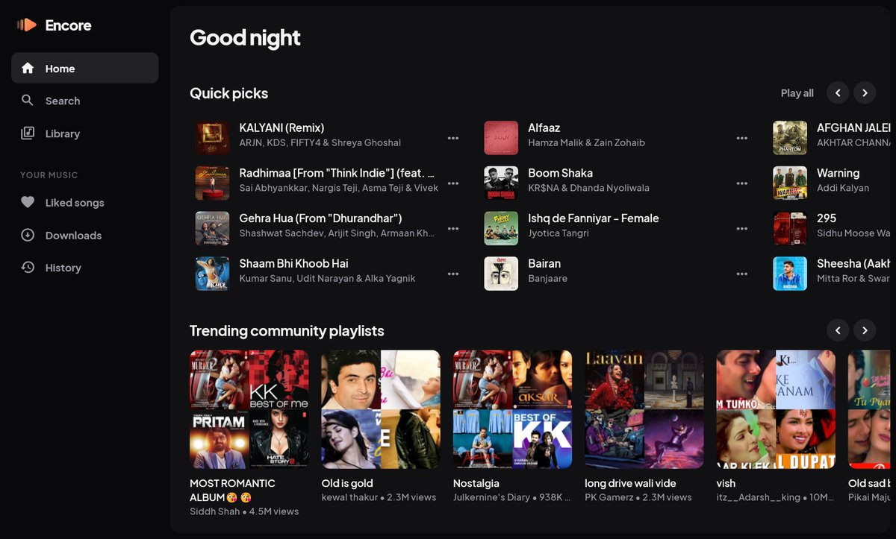
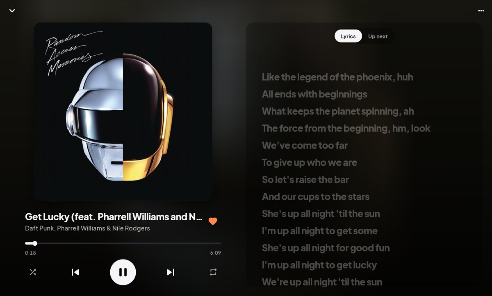
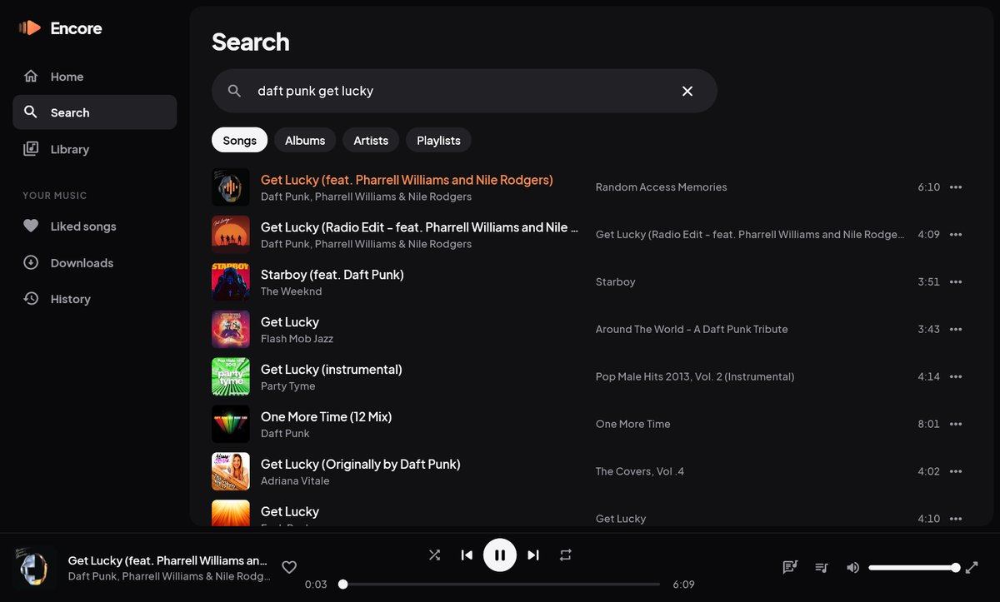
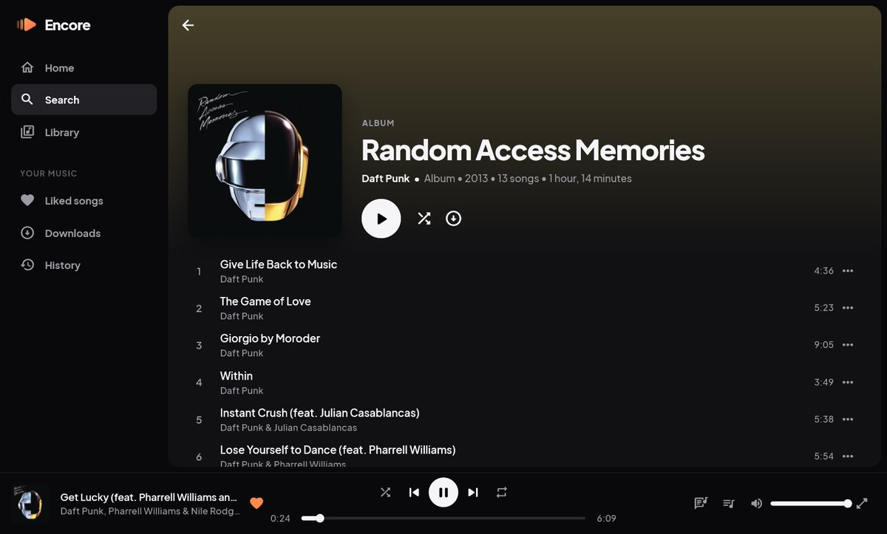

<p align="center">
  
</p>

<h1 align="center">Encore</h1>

<p align="center">
  An ad-free music player for YouTube Music — Android, Windows and Linux.
</p>

<p align="center">
  
  
  
  
</p>

## Features

- No ads, no account, no tracking
- Home feed, search with suggestions (songs, albums, artists, playlists)
- Song radio, up next, shuffle and repeat
- Artist, album and playlist pages
- Synced lyrics
- Likes, history and downloads for offline listening, kept on your device
- Keeps playing in the background on Android, with controls in the
  notification panel and lock screen
- Keyboard shortcuts on desktop

## Install

Download the latest version from the **Releases** page of this repository
(right-hand side on GitHub → *Releases*).

> This repository is private: you need a GitHub account and an invite from
> the owner to see the downloads.

### Android

1. Download **`encore-android.apk`** on your phone.
2. Open it. If asked, allow your browser or file manager to
   *install unknown apps*.
3. Open Encore and tap **Allow** when it asks to show notifications — that is
   what puts the player in your notification panel.

Updating: install the new APK over the old one; your likes and downloads stay.

### Windows

Download **`encore-windows-setup.exe`** and run it. If Windows SmartScreen
says it protected your PC, click **More info → Run anyway** (the installer
isn't code-signed). It needs no admin rights and adds Encore to the Start menu.

Prefer no installer? Unzip **`encore-windows-portable.zip`** anywhere and run
`encore.exe`.

### Linux

Encore needs **libmpv** for audio:

```sh
sudo apt install libmpv2          # Debian / Ubuntu 24.04+ (libmpv1 on older)
sudo dnf install mpv-libs         # Fedora
sudo pacman -S mpv                # Arch
```

Then extract and run:

```sh
mkdir -p ~/encore && tar -xzf encore-linux-x64.tar.gz -C ~/encore
~/encore/encore
```

## Keyboard shortcuts (desktop)

| Key | Action |
|---|---|
| Space or K | Play / pause |
| ← / → | Seek 10 seconds |
| Ctrl + ← / → | Previous / next song |
| Ctrl + ↑ / ↓ | Volume |
| L | Like the current song |

## Good to know

Encore is unofficial: it uses YouTube Music's internal API, which YouTube can
change at any time. If songs stop playing, an update to Encore is usually
needed. It isn't affiliated with or endorsed by YouTube or Google.

---

## For developers

Requires Flutter 3.47+.

```sh
flutter pub get
flutter run -d windows   # or: -d linux, or an Android device
```

See [DESIGN.md](DESIGN.md) for the structure and design decisions.

### Releases

Push a version tag; GitHub Actions (`.github/workflows/build.yml`) tests,
builds every platform and publishes a release:

```sh
git tag v0.2.0 && git push origin v0.2.0
```

Android releases are signed with a key stored as repository secrets
(`ANDROID_KEYSTORE_BASE64`, `ANDROID_KEYSTORE_PASSWORD`, `ANDROID_KEY_ALIAS`,
`ANDROID_KEY_PASSWORD`). To sign locally, put the same values in
`android/key.properties` (ignored by git). App icons are generated by
`python tool/icons.py .`.

### Tests

| What | Command |
|---|---|
| Unit + widget (offline) | `flutter test test/unit test/widget` |
| Live API checks | `flutter test test/live` |
| End-to-end, real audio | `flutter test integration_test/app_test.dart --dart-define=ENCORE_TEST=true -d <device>` |
| Android background playback | `sh tool/android_background_check.sh <device>` |
| Linux, in Docker | `docker build -t encore-linux-test tool/linux_test` then `docker run --rm -v "$PWD:/src" encore-linux-test` |
| Frame timings | `flutter drive --profile --no-dds --driver=test_driver/perf_driver.dart --target=integration_test/perf_test.dart -d <device>` |

`ENCORE_TEST` keeps the tests' likes, history and downloads separate from
your own. End-to-end tests run a debug build, so they look slower than the
real app; use the frame-timing test to judge smoothness.

## License

[GPL-3.0](LICENSE)
